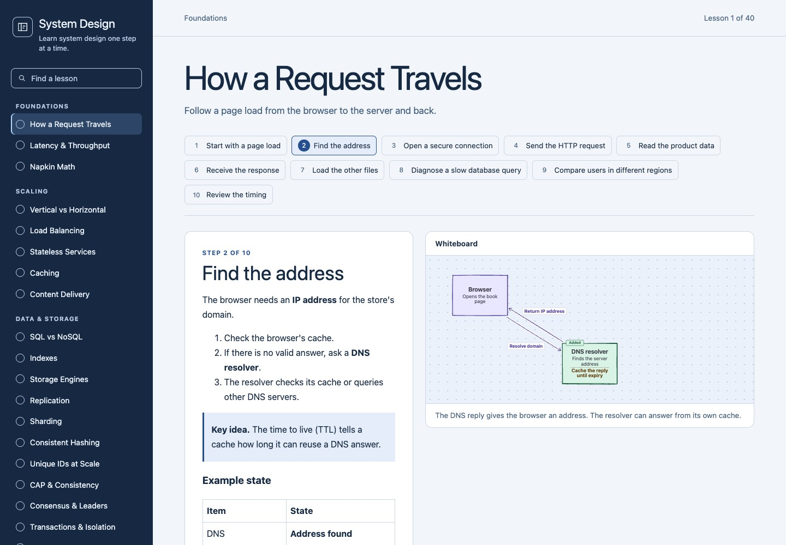
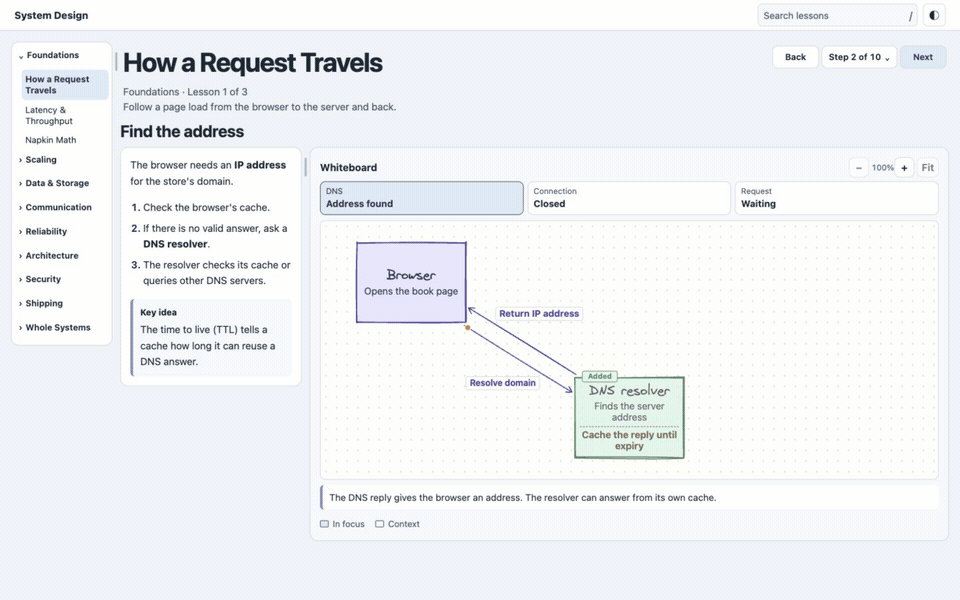

# System Design Study Course

A local, editable course for learning system design one step at a time. 📚 Explore 40 lessons in nine chapters, from request lifecycles and caching to URL shorteners, news feeds, and chat systems.

**[Open the course](https://www.lprakashv.com/designed-to-scale/)** · [Run locally](#run-locally) · [Add a lesson](#add-content) · [Contribute](CONTRIBUTING.md)



The chapter names, lesson names, and lesson order follow Dilum Sanjaya’s [Designed to Scale course](https://designed-to-scale.vercel.app/). The local text and diagrams are independently written. Foundations, load balancing, and Whole Systems have expanded walkthroughs. The remaining 32 lessons give three-step introductions.

## Explore the course 🔍

Browse chapters in the navigation pane. The current chapter opens automatically. Use **Back**, **Next**, the step selector, or the arrow keys to move between steps. Use **/** or **Ctrl+K** (**Command+K** on Mac) to search. Enter opens the first result; Escape closes and clears the search.

On wide screens, drag the dividers to resize the navigation, guide, and whiteboard. With a divider focused, use **Left** and **Right** to resize or **Home** and **End** to reach its limits. On narrow screens, the board and guide stack. The title and lesson controls stay visible as you scroll.

The board starts fitted to the diagram. Use **+** or pinch outward to zoom, then drag to pan. Select **Fit** to restore the full view. With the board focused, use **+**, **−**, or **0** to change zoom; the arrow keys pan while zoomed in. The view stays in place between steps of the same lesson.

Each lesson builds one board with fixed component positions. **Added** marks a component's first step. Purple boxes show the current focus; plain boxes show context. Box notes explain decisions or state changes. Labeled arrows show the current operations and animate once in link order. Steps without arrows and browsers set to reduce motion show static diagrams. State cards compare each step with the preceding step, including when you open a direct link.

The Excalidraw-style boards use [Rough.js](https://github.com/rough-stuff/rough) and [Virgil](https://github.com/excalidraw/virgil). The build serves the drawing code and font locally.



See the [URL shortener example](showcase/url-shortener.jpg) and [dark theme](showcase/dark-mode.jpg) for more views.

## Project map 🗂️

| Path | Purpose |
| --- | --- |
| `content/index.json`, `content/lessons/` | Chapter order and Markdown lesson sources |
| `app.js`, `index.html`, `styles.css` | Course interface, navigation, and styling |
| `scripts/` | Content compiler, validation, diagrams, pane controls, and local server |
| `test/` | Node tests for content and interface logic |
| `showcase/` | Screenshots and the walkthrough recording |
| `.github/workflows/` | Pull request checks and Pages deployment |

The compiler converts lesson sources into `content/course.json` in the build. The browser loads and validates this data, then renders the selected lesson and diagram. See [AGENTS.md](AGENTS.md) for development conventions.

## Requirements

Node.js 20.19 or later and npm. The development server and build use Markdown-it and YAML. A deployed site serves static files.

## Run locally

```sh
npm ci
npm run dev
```

Open <http://127.0.0.1:4173>. Save a course document and reload the page to see the changes. The server restarts when its JavaScript modules change. Press `Ctrl+C` to stop it. Set `PORT` to use another port:

```sh
PORT=4174 npm run dev
```

## Deploy

Pushes to `main` run the GitHub Actions workflow. The workflow installs the locked dependencies, validates and builds the course, and publishes `dist/` to the `gh-pages` branch. GitHub Pages serves that branch at <https://www.lprakashv.com/designed-to-scale/>.

To preview the static build locally, use these commands after `npm ci`.

```sh
npm run build
npm start
```

To use another static host, publish the contents of `dist/`. The build writes the compiled data to `dist/content/course.json`. Edit the source documents to change it. The browser downloads the compiled course, so keep secrets out of the lesson files.

## Website analytics

The site uses Google Analytics 4 (GA4) for page-view tracking. The integration tracks the first view and each lesson or step change. It loads the Google tag `GTM-P54692MZ` on the deployed site. Local previews on `localhost` and `127.0.0.1` are not tracked.

The tag ID came from the GA4 web stream setup. Make sure that its Google tag sends data to this stream. Google recommends managing tag destinations in the Google tag interface. If you change the tag ID later, update `tagId` in [scripts/analytics.js](scripts/analytics.js) and deploy the change.

To verify tracking, open the deployed site and check **Reports → Realtime** in Analytics. Google says initial data can take up to 30 minutes to appear; use [Tag Assistant](https://tagassistant.google.com/) to check the tag.

Review Google's data collection and privacy settings for your audience and region, and update the site's privacy notice if required. See Google's [GA4 setup guide](https://support.google.com/analytics/answer/14183469), [Google tag setup guide](https://developers.google.com/tag-platform/gtagjs), and [tag destination settings](https://support.google.com/analytics/answer/12329709).

## Add content

1. Create a Markdown file in [content/lessons](content/lessons), with a name such as `cache-example.md`. Use lowercase letters, digits, and hyphens for the lesson ID.
2. Add the ID without `.md` to a chapter’s `lessons` list in [content/index.json](content/index.json). Set the chapter title with `title`. The index sets chapter and lesson order.
3. Run `npm run lint` to check the documents. Reload the development preview to see your changes.

Start the document with YAML front matter. Use a top-level `##` heading for each step. Place a fenced `step` block with its YAML settings immediately after the heading. Then write the lesson prose in Markdown.

````markdown
---
title: Cache Example
summary: Compare a cache hit with a cache miss.
nodes: [[Service, Handles reads], [Cache, Temporary copies], [Database, Source of truth]]
statusLabels: [Cache state]
---

## Read from the cache

```step
active: [0, 1]
links: [[0, 1, Look up record], [1, 0, Return cached record]]
callouts: [[1, Fresh entry]]
status: [Hit]
note: A hit can avoid a database read.
visualNote: The request stops at the cache.
```

The service asks the cache for a record. The cache has a **fresh entry** and returns it.

## Read from the database

```step
active: [0, 1, 2]
links: [[0, 1, Look up record], [1, 0, Report miss], [0, 2, Read source record], [2, 0, Return record]]
callouts: [[2, Read only on a miss]]
status: [Miss]
visualNote: The service reads the source after a cache miss.
```

The service reads the record from the database and fills the cache for the next request.
````

| Field | Use |
| --- | --- |
| `title`, `summary` | Set the lesson title and introduction. |
| `nodes` | List the components once for the whole lesson, using `[name, caption]` pairs. Keep labels and captions short. |
| `layout` | Optionally set a list of `[column, row]` positions in node order. Positions start at zero and may use half steps to center a component between rows or columns. |
| `original` | Set to `true` if Designed to Scale has a lesson with the same ID. This is source metadata. |
| `active` | List the component indexes to highlight. The first component has index 0. |
| `links` | Add `[from, to, label]` entries in the order to animate them. Use a short label that fits next to the arrow. Omit this field for a step without a flow. |
| `callouts` | Add at least one `[node, note]` pair to each step. Keep the note short enough to read inside its component. |
| `statusLabels`, `status` | Set optional labels for the lesson and one value per label for each step. Quote numeric values so YAML reads them as text. |
| `note`, `visualNote` | Add an optional key idea in the guide and a required caption below the whiteboard. |

A component first appears when a step references it in `active`, `links`, or `callouts`. It stays visible in later steps. Use stable names when the component changes state. Use the default layout for a simple chain. For a branch or a return path, set positions that keep connected components close and leave space for their arrows.

Write short paragraphs and put one action in each list item. Use numbered lists for a sequence and tables for comparisons. Prefer two columns so tables fit in the reading pane. Use bold for facts and values to remember. Use `> **Note.**` for a note and `> **Warning.**` for a caution. The prose also supports links and fenced code. Use `###` or smaller headings within a step. The renderer displays raw HTML as text.

Keep existing lesson IDs stable to preserve links and saved position. The order of the step headings sets the step numbers in local links. The browser saves pane widths, the last lesson and step, and the theme locally. Opening a direct lesson link takes you to that step.

## Checks

```sh
npm run lint
npm run build
npm test
npm run coverage
```

`lint` checks the source documents. `build` runs the same checks and writes the static site. Tests cover the authoring example, invalid metadata, and the diagram renderer.

## Contributing 🤝

See [CONTRIBUTING.md](CONTRIBUTING.md) for setup, content guidelines, checks, and pull requests. The CI workflow runs lint, tests, and build on Node.js 20 and 22.

## License

The original work in this repository is available under the [MIT License](LICENSE). The referenced Designed to Scale course and third-party assets remain subject to their own terms; see the notices in `assets/` and the Rough.js package.
